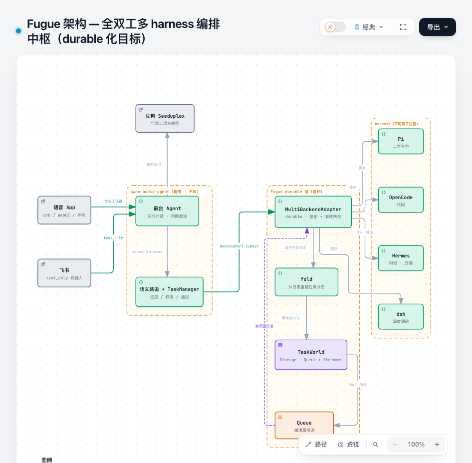
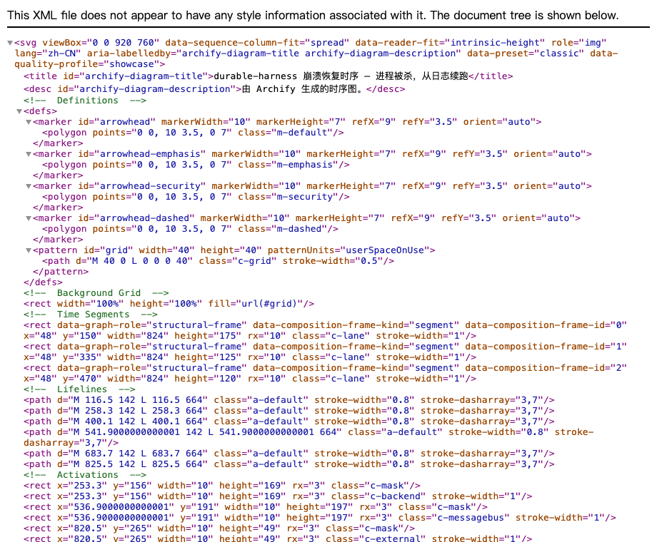
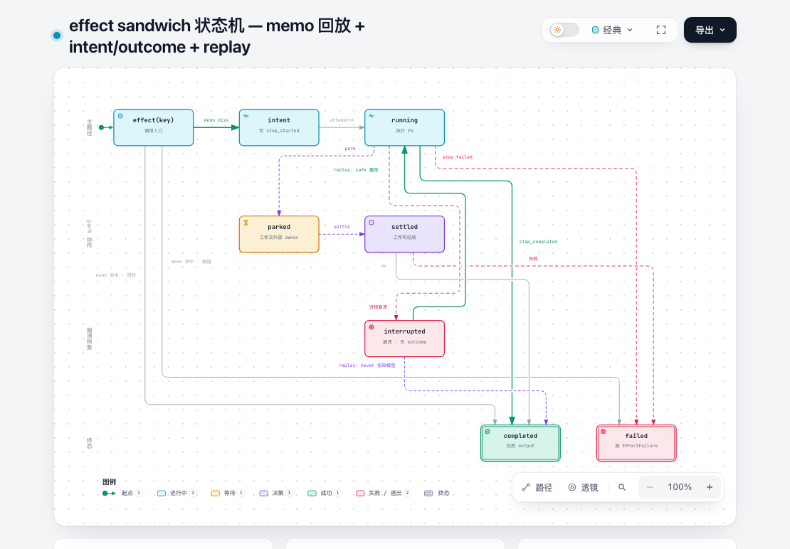

# Fugue 🎼

> **Many agents, one fugue.** — 全双工、多端可达、**崩溃可恢复**的多 agent harness 编排中枢。

[English](README.en.md) | 中文

[](https://github.com/wenliang-xiao/Fugue/stargazers)
[](https://github.com/wenliang-xiao/Fugue/network/members)
[](https://github.com/wenliang-xiao/Fugue/issues)
[](https://github.com/wenliang-xiao/Fugue/actions/workflows/ci.yml)
[](LICENSE)
[](https://nodejs.org)
[](https://www.typescriptlang.org/)

把你已有的 agent harness（本地 **OpenCode / Pi**、云端 **Hermes**、以及任意 ACP/A2A 兼容 harness）变成一个**随时随地、边聊边干、干完主动汇报、崩溃也不丢任务**的助手。

## 🏗️ 架构



三层分工：**qwen-audio-agent**（前台编排 + 多端 + 全双工，复用不改）→ **Fugue durable 层**（任务日志 + fold + 崩溃恢复，自研）→ **harness 层**（不可靠子进程，崩溃重启从日志续跑）。

## ✨ 核心特性

- 🎙️ **全双工对话** — 像打电话一样同时说和听，随时插话、随时打断，不是一问一答。
- 📱 **多端可达** — 语音 App（桌面 orb / WebUI / 手机）与飞书文字，共享同一个 Agent 的记忆、任务与状态。
- 🧩 **多 harness 委派** — 一个前台陪你聊，多个后台 harness 并行干活，按领域路由或你手动指定（"让 pi 干"）。
- 💪 **崩溃可恢复（durable）** — 任务状态写入事件日志，Gateway 或后台 harness 崩溃后从日志续跑，**完成的调用不重复、有副作用的调用不重跑**（对齐 Vercel durable-harness 设计，见[调研](docs/00-research/durable-harness-analysis.md)）。
- 🔌 **零侵入接入** — 复用你已有的 harness，不 fork 底座（qwen-audio-agent），只走它的两个标准扩展点。

## 为什么是编排，不是桥接

市面上的「飞书 agent」多是**同步桥接**（cc-connect、botmux、dsh-lark-*）：把 harness 的 stdin/stdout 转发到 IM——发指令、等结果。

Fugue 是**异步编排**：

| | 桥接（cc-connect / botmux） | Fugue（编排） |
|---|---|---|
| 交互模式 | 发指令 → 执行 → 回结果（同步 console） | 派活 → 继续聊 → 后台并行 → 主动播报 |
| 体验 | 远程操控一个终端 | 跟一个助手打电话 |
| 多任务 | 基本串行 | 多后台并行，随时问进度/取消/补信息 |
| 全双工语音 | ❌ | ✅ 核心卖点 |
| 崩溃恢复 | ❌ 进程死即丢状态 | ✅ 从事件日志续跑 |
| 多 harness | 弱（CLI 转发） | ✅ 可插拔，路由/手动指定 |
| 云端 harness（Hermes） | ❌ | ✅ 一等支持（SSH 隧道 ACP） |

## 💪 durable 化：从 durable-harness 借鉴的核心机制

任务不丢、不重复执行，靠这套设计（深入分析见 [durable-harness 深度技术分析](docs/00-research/durable-harness-analysis.md)）：

<table>
<tr>
<td width="50%"></td>
<td width="50%"></td>
</tr>
</table>

- **intent/outcome 日志**：每个委派步骤先写意图、再写结果，崩溃后日志精确回答「完成了什么 / 正在跑什么 / 没开始什么」。
- **effect sandwich + replay**：`completed` 回放结果（不重复计费）、`failed` 抛错、`running` 按 `safe/never` 策略决定重跑——`never` 的调用（如重复 submit）绝不跑两次。
- **anchor + queue backstop**：liveness 归队列，应用层不写心跳；进程死 → 队列重投递 → 新进程读日志续跑。
- **epoch fencing**：多端（语音 + 飞书）分时共享时，僵尸进程的迟到写入被 fence。

## 🚀 快速开始

```bash
# 1. 依赖（qwen-audio-agent 源码需先 npm install）
cd /path/to/qwen-audio-agent && npm install --omit=dev
cd /path/to/fugue && npm install

# 2. 配置多 harness + 飞书入口
cp config/config.example.env config/config.env
# 语音前台凭据复用 qwen-audio-agent 的 config.env（DASHSCOPE_API_KEY / DOUBAO_API_KEY）

# 3. 启动
QWEN_AUDIO_AGENT_ROOT=/path/to/qwen-audio-agent npm start
```

测试与类型检查：

```bash
npm test          # vitest：94 个测试（durable 内核 + routing + multi-backend + feishu + 端到端崩溃恢复）
npm run typecheck # tsc --noEmit（TypeScript strict）
npm run inspect   # 任务观察台：本地任务流转 / 打点 / effect 状态
npm run poc       # 上游 BackendPort 一致性套件
```

### 📡 实时观察（debug）

启动时自动开启**实时打点观察器**，委派任务时 mark/step/run 事件会实时打印到终端：

```
[fugue] 实时打点观察器已开启
07:57:57.504  [step] step_started ... (submit) replay=never
07:57:57.505  [mark] intent (submit)          ← 打点实时打印
07:57:57.506  [step] step_completed ...
07:57:57.508  [mark] complete (submit)
```

另开终端随时回看全量流转：`npm run inspect`。

## 🗺️ Roadmap：走向 agent 矩阵

```
P0 ✅ durable 地基（TS 迁移 + TaskWorld/fold/effect/anchor/fencing + 崩溃恢复端到端）
P1 ⏳ pi/opencode 接 durable storage（「agent 不会死」落地）
P2 📋 documents 共享记忆 + 并行 fan-out（矩阵雏形）
P3 📋 专家横向协作 / 调度器 / 成本账本（真矩阵）
```

## 📚 文档

- [架构设计](docs/02-tech/architecture.md) · [durable 化设计](docs/02-tech/durable-design.md) · [架构决策 ADR](docs/02-tech/adr/) · [模块设计](docs/02-tech/modules/)
- [durable-harness 深度分析](docs/00-research/durable-harness-analysis.md) · [竞品调研](docs/00-research/competitor-analysis.md)
- [产品需求 PRD](docs/01-prd/PRD.md) · [术语表](docs/glossary.md) · [评审规范](docs/03-review/review-guide.md) · [测试计划](docs/04-test/test-plan.md)
- [开发工作流 SDD](AGENTS.md) · [AI 协同规范](docs/vibe-coding.md) · [工程宪法](CONSTITUTION.md)

## License

[MIT](LICENSE)
