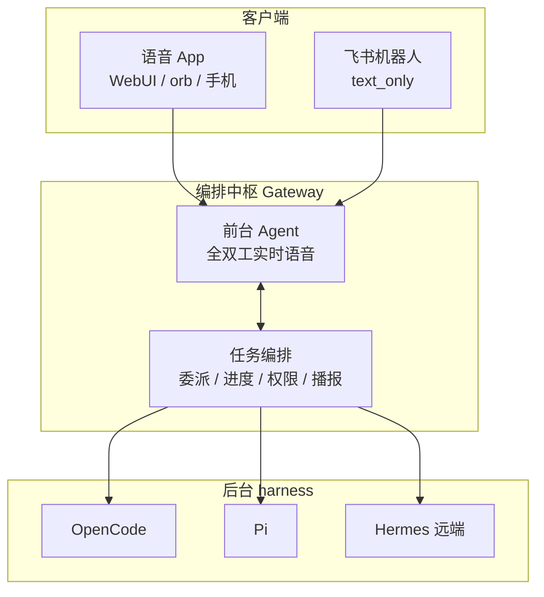

# Fugue 🎼

> **Many agents, one fugue.** — 全双工、多端可达、可委派多种 agent harness 的对话编排中枢。

[English](README.en.md) | 中文

[](https://github.com/wenliang-xiao/Fugue/stargazers)
[](https://github.com/wenliang-xiao/Fugue/network/members)
[](https://github.com/wenliang-xiao/Fugue/issues)
[](https://github.com/wenliang-xiao/Fugue/actions/workflows/ci.yml)
[](LICENSE)
[](https://nodejs.org)

把你自己已有的 agent harness（本地 OpenCode / Pi、云端 Hermes，以及任意 ACP/A2A 兼容的 harness）变成一个**随时随地、边聊边干、干完主动汇报**的助手。

## ✨ 核心特性

- 🎙️ **全双工对话** — 像打电话一样同时说和听，随时插话、随时打断，不是一问一答。
- 📱 **多端可达** — 语音 App（桌面 orb / WebUI / 手机）与飞书文字，共享同一个 Agent 的记忆、任务与状态。
- 🧩 **多 harness 委派** — 一个前台陪你聊，多个后台 harness 并行干活，按任务类型路由或你手动指定。
- 🔌 **零侵入接入** — 复用你已有的 harness，不 fork 底座（qwen-audio-agent），只走它的两个标准扩展点。

## 🎬 Demo

<!-- TODO: 录制一段「飞书/语音派活 → 后台执行 → 主动播报」的 GIF 放在这里 -->

```
对话 → 前台(豆包全双工)判断派活 → spawn_thinking 委派 → opencode 后台执行 → 任务完成 → 主动播报
```

## 🏗️ 架构



基于 [qwen-audio-agent](https://github.com/QwenAudio/qwen-audio-agent)（Apache-2.0），通过两个标准扩展点接入：多 harness 走 `BackendPort` 聚合，飞书入口走 Gateway Client Protocol。详见 [架构设计](docs/02-tech/architecture.md)。

## 为什么是编排，不是桥接

市面上的「飞书 agent」多是**同步桥接**（cc-connect、botmux、dsh-lark-*）：把 harness 的 stdin/stdout 转发到 IM——发指令、等结果。

Fugue 是**异步编排**：

| | 桥接（cc-connect / botmux） | Fugue（编排） |
|---|---|---|
| 交互模式 | 发指令 → 执行 → 回结果（同步 console） | 派活 → 继续聊 → 后台并行 → 主动播报 |
| 体验 | 远程操控一个终端 | 跟一个助手打电话 |
| 多任务 | 基本串行 | 多后台并行，随时问进度/取消/补信息 |
| 全双工语音 | ❌ | ✅ 核心卖点 |
| 多 harness | 弱（CLI 转发） | ✅ 可插拔，路由/手动指定 |
| 云端 harness（Hermes） | ❌ | ✅ 一等支持（SSH 隧道 ACP） |

## 🚀 快速开始

```bash
# 1. 依赖（qwen-audio-agent 源码需先 npm install）
cd /path/to/qwen-audio-agent && npm install --omit=dev
cd /path/to/fugue && npm install

# 2. 配置多 harness + 飞书入口
cp config/config.example.env config/config.env

# 3. 语音前台凭据（复用 qwen-audio-agent 的 config.env，如 DASHSCOPE_API_KEY / DOUBAO_API_KEY）

# 4. 启动
QWEN_AUDIO_AGENT_ROOT=/path/to/qwen-audio-agent npm start
```

测试：

```bash
npm test       # 35 个测试（routing / multi-backend / message-bridge / feishu-client）
npm run poc    # 上游 BackendPort 一致性套件
```

## 📚 文档

- [架构设计](docs/02-tech/architecture.md) · [架构决策 ADR](docs/02-tech/adr/) · [模块设计](docs/02-tech/modules/)
- [产品需求 PRD](docs/01-prd/PRD.md) · [术语表](docs/glossary.md) · [竞品调研](docs/00-research/competitor-analysis.md)
- [评审规范](docs/03-review/review-guide.md) · [测试计划](docs/04-test/test-plan.md)
- [开发工作流 SDD](AGENTS.md) · [AI 协同规范](docs/vibe-coding.md) · [工程宪法](CONSTITUTION.md)

## License

[MIT](LICENSE)
