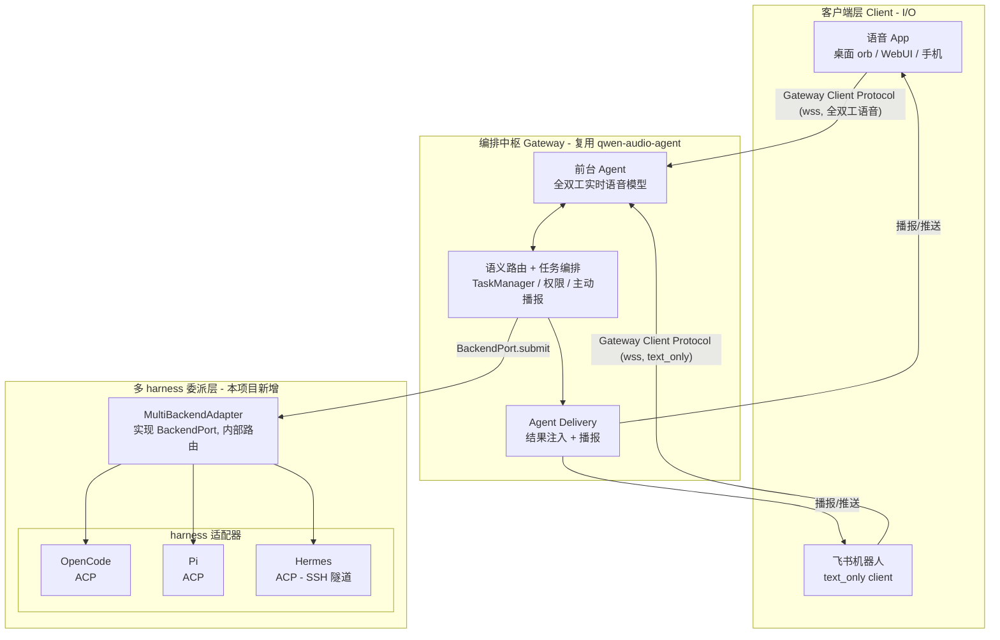
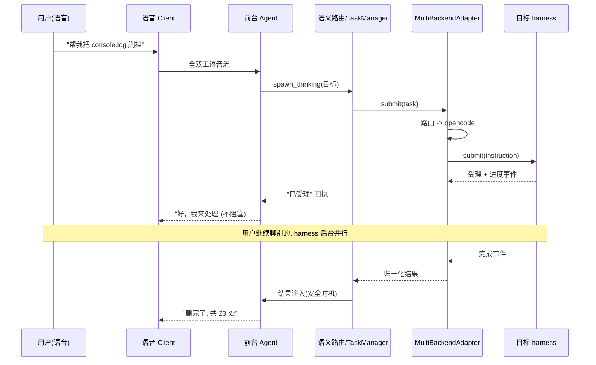
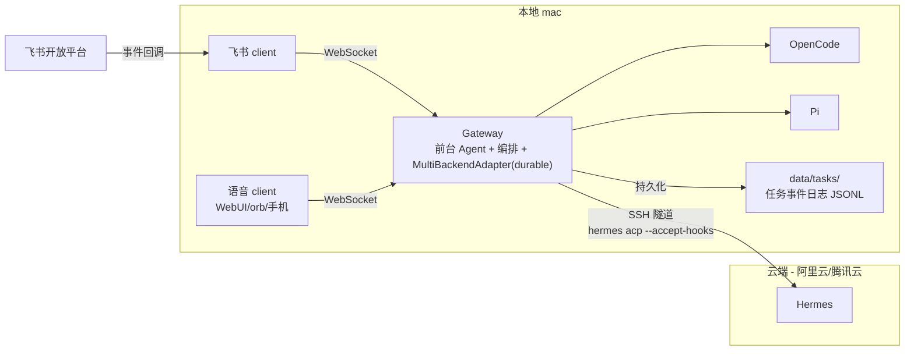

# 架构设计 — Fugue

> 版本：v0.1（规格阶段首版）
> 状态：待评审
> 关联：[PRD](../01-prd/PRD.md) · [ADR](./adr/)

---

## 1. 总体架构

复用 [qwen-audio-agent](https://github.com/QwenAudio/qwen-audio-agent) 的编排运行时，**不 fork core**，通过两个标准扩展点接入。架构分三层，与 qwen-audio-agent 一致，但后台 Agent 从"单 backend"替换为"多 harness 聚合"。



**三个关键点**：

1. **前端不变**：前台 Agent（全双工语音模型）+ 语义路由 + Agent Delivery 全部复用，一行不改。
2. **后台替换**：`createGatewayApplication({ agent })` 传入的 agent 由 `createBackendAgentHost(new MultiBackendAdapter([...]))` 提供，把"单 backend"变成"多 harness 聚合"。
3. **双端共享**：语音 App 与飞书 client 轮流连同一个 Gateway（`session.takeover` + `session.replay`），任务/记忆在 Gateway 层持久化，天然共享。

---

## 2. 模块划分

| 模块 | 目录 | 新增/复用 | 职责 | 对应 REQ |
|------|------|-----------|------|---------|
| `gateway` | 上游 | 复用 | 编排中枢（前台 Agent、任务、权限、播报） | 全部 |
| `multi-backend-adapter` | 新增 | **核心新增** | 聚合多 harness，实现 BackendPort，内部路由 | REQ-005 |
| `feishu-client` | 新增 | **核心新增** | 飞书机器人，text_only client，接 Gateway Client Protocol | REQ-002 |
| `harness-adapters` | 新增 | 复用上游 ACP driver | opencode/pi 复用；Hermes 通过 SSH 隧道 | REQ-004/007 |
| `durable` | 新增 | **核心新增** | 任务持久化内核：TaskWorld/fold/effect/anchor/fencing（对齐 durable-harness） | ADR-0009 |
| `core` | 新增 | **核心新增** | 可观测基础设施：logger/marks/audit/live-watcher | ADR-0009 |
| `launcher` | 新增 | 新增 | 自定义 Gateway launcher，组装 MultiBackendAdapter | REQ-004 |

### 2.1 multi-backend-adapter（核心，durable 化）

实现协议无关的 `BackendPort`（上游 SDK 提供），内部维护多个 backend 与路由表，并**可选接入 durable 内核**（ADR-0009）：

```
MultiBackendAdapter
├── backends: Map<backendId, BackendPort>   # opencode / pi / hermes
├── router: Task -> backendId                # 显式指定 > 规则 > 默认
├── taskMap: Map<gatewayTaskId, backendId>   # 内存缓存，崩溃后从日志重建
├── world?: TaskWorld                        # durable：任务事件日志（Storage+Queue+Streamer）
└── subscribe: 聚合所有 backend 事件，按 gatewayTaskId 归一化后转发
```

**durable 化（ADR-0009，详见 [durable-design.md](./durable-design.md)）**：
- `submit` 走 `effect(replay: never)` —— 写 intent → 跑 backend.submit → 写 outcome；崩溃后 `never` 不重跑，防重复任务。
- `taskMap` 从日志 fold 重建（`rebuildTaskMap()`），进程重启后恢复任务归属。
- 任务状态持久化到本地 `data/tasks/`（world-file），个人助手本地真实跑、崩溃可恢复。

**路由优先级**（P1 首版）：`显式指定（用户说"让 Hermes 干"）` > `规则匹配（简单关键词/任务类型）` > `默认 backend`。智能路由（按任务类型自动选）是 P2。

**关键约束**（来自上游 BackendPort 契约）：
- `submit(task)` 只接收结构化 Task + 一个 canonical `instruction`，路由/关联字段在 adapter 内部使用，**不进入模型可见文本**。
- 所有 backend 事件通过 `subscribe` 归一化为 `backend.activity/message/artifact`，按 `taskId` 转发；原始协议对象不跨边界。
- 权限（`respondAuthorization`）与输入请求（`respondInput`）按 `taskMap` 映射回目标 backend。

### 2.2 feishu-client（核心）

飞书机器人作为 qwen-audio-agent 的**一个 Client**，走 Gateway Client Protocol（WebSocket，`/api/realtime`）：

- 以 `text_only: true` 协商，声明 `input.text` 能力（不声明音频）。
- 飞书消息 → `conversation.item.create`（文本）→ 前台 Agent 回复 → `response.output_audio_transcript.delta` → 机器人把文本发回飞书。
- 任务完成 → Gateway 推送 `task.updated` → 机器人发飞书卡片/消息（进度、结果、权限请求按钮）。
- 通过 `session.takeover` 与语音 client 分时共享；重连用 `session.replay` 恢复错过的任务事件。

飞书开放平台能力边界（已在 PRD 决策 2 记录）：
- ✅ 收文本、收/发语音消息（异步半双工，P1 的 REQ-008）
- ❌ 不开放第三方 RTC 接入（真全双工语音只能走语音 App）

### 2.3 harness-adapters

| harness | 接入方式 | 备注 |
|---------|---------|------|
| OpenCode | ACP stdio（复用上游 driver） | `opencode`，本地 |
| Pi | ACP stdio（复用上游 driver，走 pi-acp adapter） | 注意：Pi 无权限审批，等价 full 权限 |
| Hermes | ACP stdio，经 SSH 隧道 | `ssh <host> hermes acp --accept-hooks`，远端 |

Hermes 远端接入的候选方案见 [ADR-0004](./adr/0004-hermes-remote-access.md)。

---

## 3. 关键数据流

### 3.1 语音派活 → 后台执行 → 主动播报（REQ-001/006）



### 3.2 飞书文字派活（REQ-002/003）

与 3.1 同构，只是入口换成飞书 client：飞书消息 → `conversation.item.create` → 前台 Agent；结果经 `task.updated` 推送 → 飞书卡片。**与语音走同一个 TaskManager**，故任务状态天然共享。

---

## 4. 关键接口契约

### 4.1 BackendPort（复用，上游 SDK 定义）

```js
{
  describe, start, health, submit, status, cancel,
  respondAuthorization, respondInput, subscribe, close
}
```

MultiBackendAdapter 实现该完整接口，对上游 Gateway 呈现为"一个 backend"。

### 4.2 MultiBackendAdapter 内部接口（新增，TypeScript）

```ts
class MultiBackendAdapter implements BackendPort {
  constructor(backends: Record<backendId, BackendPort>, options: {
    router?: Router
    defaultBackend?: string
    rules?: Array<{backendId, match}>
    world?: TaskWorld   // durable：任务事件日志（可选）
  })
  submit(work, context): Promise<unknown>   // durable 时走 effect(replay: never)
  rebuildTaskMap(): Promise<void>           // 崩溃后从日志重建 taskMap
  // BackendPort 其余方法，内部按 taskMap 映射转发
}
```

### 4.3 TaskWorld 接口（durable 内核，新增）

```ts
interface TaskWorld {
  // Storage：任务事件日志（唯一真相源）
  append(runId, event): Promise<void>
  read(runId, after?): Promise<{ events, offset }>
  listActiveRuns(): Promise<ActiveRun[]>
  setRunStatus(runId, status): Promise<void>
  // Queue：崩溃重投递（backstop）
  send(runId, payload?): Promise<void>
  onMessage(handler): () => void
  // Streamer：实时事件流（打点/进度）
  publish(runId, event): void
  subscribe(runId, listener): () => void
  subscribeAll(listener): () => void   // 全局观察（实时打点）
}
```

### 4.4 Gateway 组装（launcher，TypeScript）

```ts
import { createGatewayApplication } from 'qwen-audio-agent/gateway-application'
import { createBackendAgentHost } from 'qwen-audio-agent/backend-adapter-sdk'
import { MultiBackendAdapter } from './backend/multi-backend-adapter'
import { createFileWorld } from './durable/world-file'

const world = createFileWorld(resolve(process.cwd(), 'data', 'tasks')) // 本地持久化
const mba = new MultiBackendAdapter({ opencode, pi, hermes }, { router, world })
await mba.rebuildTaskMap()  // 重启恢复
const agent = createBackendAgentHost(mba)
const app = createGatewayApplication({ agent })
```

---

## 5. 部署拓扑



- 语音模型（前台 Agent）走云端 API（DashScope / 豆包等，密钥配置在上游 config）。
- 飞书 client 与 Gateway 同机（loopback），飞书开放平台通过公网回调触达（需内网穿透或反向代理）。
- Hermes 经 SSH 隧道把远端 stdio ACP 透传到本地 Gateway。
- **任务状态持久化到本地 `data/tasks/`（world-file JSONL），个人助手本地真实跑、崩溃重启从日志恢复（ADR-0009）**。

---

## 6. 关键技术风险与验证点

| 风险 | 验证方式 | 状态 |
|------|---------|------|
| MultiBackendAdapter 能否通过上游 conformance suite | `verifyBackendAdapterConformance` | ✅ 已通过（`poc/run-conformance.mjs`） |
| 飞书 client 的 text_only 协商与任务推送 | 最小 client 冒烟 | ✅ 已验证（飞书长连接收发正常） |
| Hermes 经 SSH 隧道走 ACP 的稳定性 | 手工 + 断线重连用例 | Hermes ACP 已确认 stdio-only（ADR-0004）；SSH 稳定性待实测 |
| 上游 Gateway "单 client" 对双端分时的影响 | takeover + replay 用例 | ✅ takeover 已验证 |
| durable 内核正确性（fold/effect/anchor/fencing） | 单元测试 + SIGKILL 端到端 | ✅ 94 测试全绿（含真实 SIGKILL 崩溃恢复） |
| 真实 harness 委派 + 崩溃恢复 | 真实委派验证 | ⏳ 待真实任务验证（基础设施已就绪） |

详见各 [ADR](./adr/) 与 [测试计划](../04-test/test-plan.md)。
