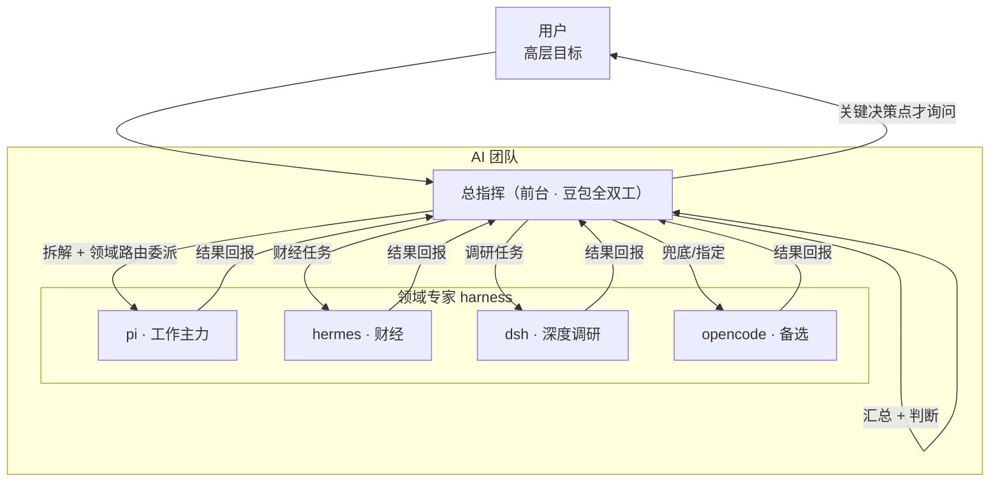

# 协调模型设计 — Fugue：AI 团队总指挥

> 版本：v0.1
> 关联：[PRD](../01-prd/PRD.md) · [架构](architecture.md) · ADR

---

## 1. 愿景

> 用户给一个**高层目标**，Fugue 自动拆解、协调多个领域专家（harness）完成，**自动判断、自动继续、自动换专家**，只在关键决策点（权限、不可逆操作、方向性选择）向用户确认。

用户不再需要在每个子任务结束后手动说「继续」「不对」「你帮我」。

## 2. 核心模型：总指挥居中协调



**关键设计决策：总指挥居中协调，专家之间不直接互相委派。**

- 专家 A 的产出不直接给专家 B，而是回报总指挥；总指挥判断后决定「继续 / 重做 / 换专家 B」。
- 等效实现"互相委派"，但绕开了 qwen-audio 的 `third-layer delegation`（Pi 等 backend 不支持，见 ADR 风险）。

## 3. 角色定义

| 角色 | 实体 | 职责 |
|------|------|------|
| **总指挥（Conductor）** | 前台豆包（实时对话模型） | 理解意图、拆解任务、委派、判断结果、自动继续、汇总汇报、关键点才问用户 |
| **领域专家（Specialists）** | pi / hermes / dsh / opencode | 各自领域的专业执行，完成任务回报结果 |

## 4. 协调流程（一个完整的高层目标）

```
① 用户给高层目标
② 总指挥拆解成子任务（自动）
③ 按领域路由（或用户显式指定）委派给专家
④ 专家执行 → 回报结果
⑤ 总指挥判断：结果对不对？
   ├─ 对 → 汇总，继续下一个子任务（回到 ③）
   ├─ 不对 → 带着纠正重新委派（回到 ③，不打断用户）
   └─ 需要换专家 → 改派给另一个专家（回到 ③）
⑥ 全部完成 → 向用户汇报最终结果
⑦ 仅在关键决策点（权限/不可逆/方向分叉）暂停问用户
```

## 5. 关键机制

| 机制 | 现状 | 说明 |
|------|------|------|
| **领域路由** | ✅ 已实现 | 关键词 → 专家（财经→hermes，调研→dsh，默认→pi）|
| **显式指定** | ✅ 已实现 | 用户说"让 pi 干" → objective 含关键词 → 路由到 pi |
| **多轮委派** | ✅ qwen-audio 原生 | 前台实时模型可多次调用 `spawn_thinking` |
| **自动判断/继续** | ⏳ 待配置 | 靠自定义 `spawnThinkingDescription`（见 §7）注入协调语义 |
| **互相委派（专家↔专家）** | ❌ 用总指挥居中替代 | qwen-audio `third-layer delegation` 对 Pi 等不可用 |

## 6. 与竞品的差异

| | ccteam | qwen-audio 原版 | Fugue |
|---|--------|----------------|-------|
| 协调者 | 某个 vendor session（重） | 前台（单 backend） | **前台（总指挥）+ 多专家** |
| 委派粒度 | session 间 delegate | 前台 → 单 backend | 前台 → 多专家（领域路由）|
| 自动协调 | ✅（completion 通知） | ❌ 用户手动判断 | ✅ 总指挥自动判断继续 |
| 语音 | ❌ | ✅ | ✅ 全双工 + 文本 |

## 7. 实现路径（分阶段）

### P0 · 总指挥提示词（不改 core，用 `spawnThinkingDescription`）

`createGatewayApplication({ spawnThinkingDescription })` 注入协调语义，让前台知道：
- 它是一个「多专家团队的总指挥」；
- 有哪些领域专家（pi/hermes/dsh/opencode）及其擅长；
- 委派后要**自动判断结果**，不对就带着纠正重新委派，需要换专家就改派；
- 只在关键决策点问用户，其余自动继续。

### P1 · 显式指定增强

让前台在 objective 里保留用户指定的专家（"让 pi 干" → 路由到 pi），当前靠关键词已部分支持，P1 显式化。

### P2 · 专家画像与路由优化

- 每个专家一份画像（能力、边界、偏好），随路由/提示词下发；
- 路由从"关键词"演进到"语义匹配"（前台判断最适合的专家）。

### P3 · 真互相委派（可选，需上游支持）

若未来上游完善 `third-layer delegation`（Pi 等 backend 支持），再引入专家间直接委派。

## 8. 技术可行性与风险

| 项 | 判断 | 依据 |
|----|------|------|
| 前台多轮委派 | ✅ | 实时模型多轮工具调用（已验证 spawn_thinking 单轮成功）|
| 前台自动判断结果 | ✅ | 豆包是 LLM，可判断质量并带纠正重新委派 |
| 自定义协调语义 | ✅ | `createGatewayApplication` 暴露 `spawnThinkingDescription` |
| 专家间直接委派 | ❌→用居中替代 | Pi 等不支持 third-layer delegation |

**风险**：自动协调的可靠性取决于前台模型的指令遵循能力；需设计"关键决策点必问"的兜底（权限/不可逆操作永远暂停问用户，已在 qwen-audio 权限模型内）。

## 9. 待验证

1. `spawnThinkingDescription` 注入后，前台是否按"总指挥"语义多轮协调（需实测）。
2. 多轮委派 + 自动判断的稳定性（连续 3-5 轮委派不跑偏）。
3. 领域路由 + 显式指定的组合行为。
